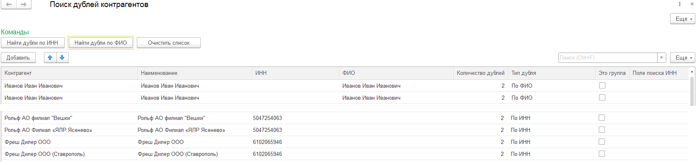
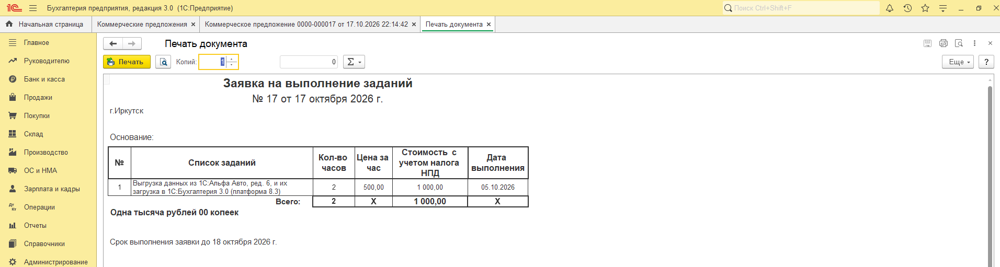
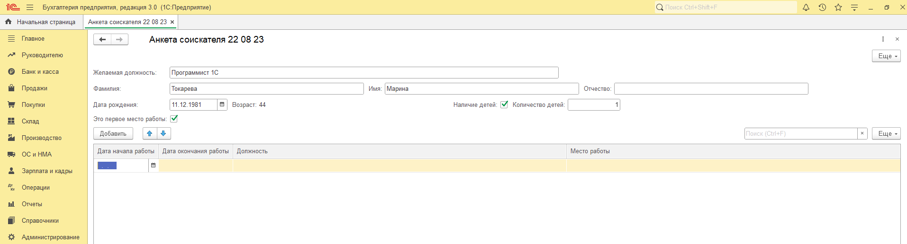
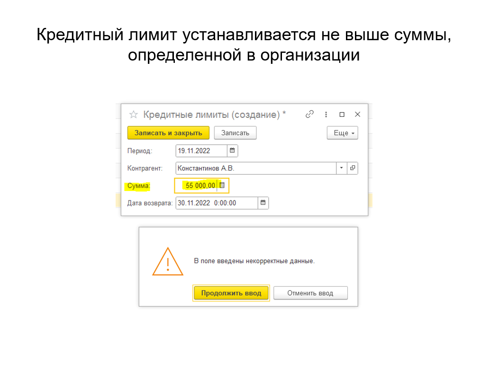
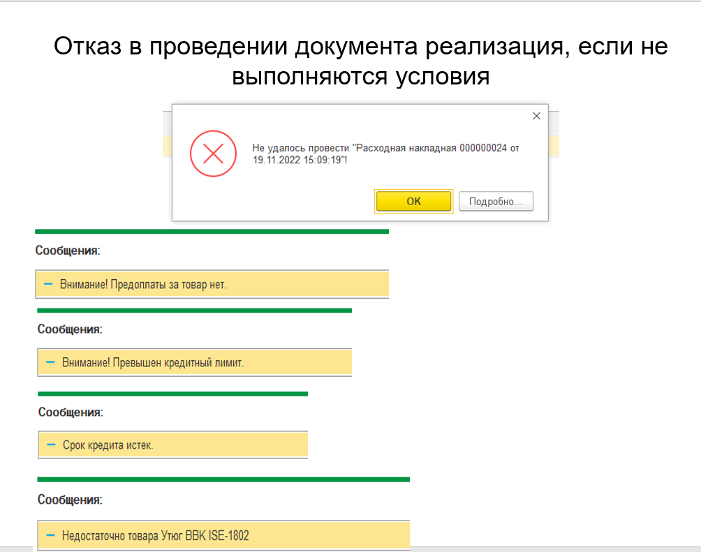
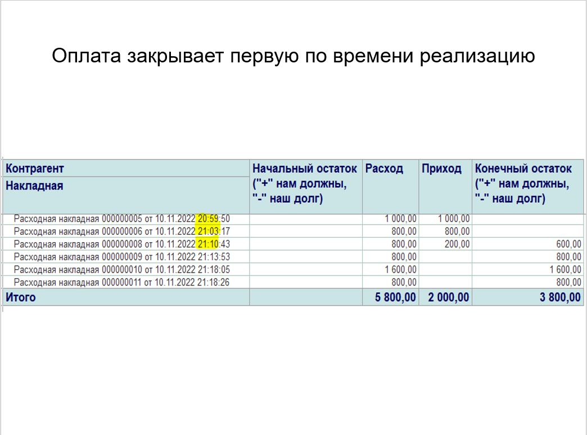
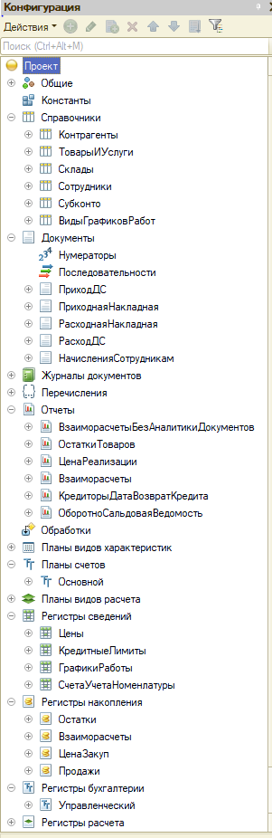

# Портфолио проектов 1С

## 1. Внешняя обработка «ПоискДублейКонтрагентов для АА»

Разработана для конфигурации «1С:Альфа Авто: Автосалон + Автосервис + Автозапчасти Проф.», редакция 6, на платформе 8.3. Предназначена для выявления дублей контрагентов по комбинации ИНН и ФИО. Результат выводится в табличный документ.

## 2. Внешняя печатная форма «Печатная форма Заявка»

Реализована для документа «Коммерческое предложение» в конфигурации «1С:Бухгалтерия предприятия 3.0» на платформе 8.3. Доработана в рамках расширения конфигурации: в макет печатной формы добавлен реквизит «Дата выполнения» в виде отдельной колонки.

## 3. Внешняя обработка «АнкетаСоискателя» (демо вариант)

Разработана на управляемых формах и демонстрирует навыки работы с интерфейсом и динамическим управлением элементами формы:

- автоматический расчёт возраста на основании введённой даты рождения;
- условная видимость поля «Количество детей» при установке флажка «Наличие детей»;
- блокировка поля «Дата окончания работы» при выборе флажка «Это первое место работы».

## 4. Внешняя обработка «Сверка НДС: сч. 62.02 и сч. 76.АВ с 2026 г.»

Разработана для конфигурации «1С:Бухгалтерия предприятия 3.0» на платформе 8.3. Выполняет сверку сумм НДС по счетам 62.02 и 76.АВ в разрезе договоров и документов. Расхождения выводятся в табличную часть с указанием документа, контрагента и суммы. Реализована поддержка периодов с 2026 года с учётом изменения ставки НДС до 22%.

## 5. Мини конфигурация для учёта в кондитерском производстве

Самостоятельная разработка на платформе 1С:Предприятие 8.3. Реализован базовый контур производственного учёта:

- справочники: «Номенклатура» (с разделением на ингредиенты и готовую продукцию), «Склады»;
- документы: «Поступление товаров», «Выпуск продукции»;
- перечисления: «Типы номенклатуры»;
- регистры накопления: «Остатки материалов»;
- отчёты: «Остатки», «Остатки ингредиентов».

В составе конфигурации представлены две обработки «Поиск дублей номенклатуры» и «Поиск дублей номенклатуры1», реализующие одинаковый результат разными техническими подходами (через запрос и через перебор элементов) — это демонстрирует владение различными методами работы с данными.

## 6. Конфигурация «Учёт на предприятии» (самостоятельная разработка на платформе 1С:Предприятие 8.3)

Конфигурация предназначена для автоматизации торгового учёта с поддержкой реализации с отсрочкой платежа и по предоплате, контролем остатков и взаиморасчётов. Проект демонстрирует навыки проектирования архитектуры данных, реализации сложной бизнес логики проведения документов и работы с управляемыми формами.

### Функциональные возможности

- **Реализация с разными условиями оплаты.** Поддержка двух сценариев: 100% предоплата и реализация с отсрочкой платежа. В документе «Реализация товаров и услуг» тип продажи определяется автоматически на основании реквизитов контрагента и условий договора.
- **Закупки.** Документ «Поступление товаров» обеспечивает ввод данных о закупках с автоматическим формированием движений по регистрам накопления.
- **Управление ценами.** Изменение цен реализации реализовано через периодический регистр сведений «Цены», что позволяет хранить историю цен и автоматически подставлять актуальные значения в документы.
- **Кредитный контроль.** Автоматический расчёт доступного лимита по контрагенту с учётом текущей задолженности и срока действия лимита.
- **Складской учёт.** Контроль остатков в разрезе номенклатуры; проведение документа блокируется при попытке отгрузки «в минус».

### Бизнес логика и ключевые точки контроля

- **Автоподстановка и блокировка цен.** В документе реализации цена подтягивается из регистра «Цены» на дату документа и недоступна для редактирования пользователем — допускается изменение только количества.
- **Фиксированный кредитный лимит.** Для каждого контрагента устанавливается лимит (в проекте — 50 000 руб.). При попытке провести реализацию на сумму выше лимита система формирует сообщение об ошибке с указанием остатка доступного лимита.

  

- **Условия проведения реализации.** Проведение документа блокируется при выполнении любого из условий:
  - отсутствует 100% предоплата (для продаж без отсрочки);
  - превышен кредитный лимит контрагента;
  - истёк срок действия предоставленного лимита;
  - на складе недостаточно свободного остатка товара.

  

- **Автоматизация оплат (FIFO).** Поступившая оплата автоматически закрывает самую раннюю неоплаченную накладную по методу FIFO, что исключает необходимость ручного сопоставления платежей с документами.

  

### Архитектура данных (на основе структуры метаданных)

- **Справочники:** «Контрагенты», «ТоварыИУслуги», «Склады», «Сотрудники» — базовые справочники для ведения учёта.
- **Документы:** «ПриходнаяНакладная», «РасходнаяНакладная», «ПриходДС», «РасходДС», «НачисленияСотрудникам» — обеспечивают ввод первичных данных и формирование движений по регистрам.
- **Регистры сведений (периодические):**
  - «Цены» — хранение цен реализации по номенклатуре с привязкой к дате;
  - «КредитныеЛимиты» — хранение лимитов по контрагентам с указанием суммы и даты окончания действия.
- **Регистры накопления:**
  - «ОстаткиТоваров» — контроль складских запасов (вид регистра — «Остатки»);
  - «Взаиморасчеты» — учёт дебиторской и кредиторской задолженности в разрезе контрагентов и документов (вид регистра — «Остатки»).
- **Отчёты:** «ВзаиморасчетыБезАналитикиДокументов», «ОстаткиТоваров», «ЦенаРеализации», «ОборотноСальдоваяВедомость», «КредиторыДатаВозвратКредита» — позволяют анализировать состояние расчётов, остатки и финансовое положение.

### Технические особенности реализации

- **Управляемые формы.** Все формы документов и справочников разработаны на управляемых формах с динамическим управлением видимостью и доступностью полей (например, отображение поля «Дата окончания кредита» только при установленном флажке «Кредит»).
- **Сложная логика проведения.** В модуле объекта документа «Реализация товаров и услуг» реализована многоэтапная проверка условий перед записью движений: контроль лимитов, сроков, остатков и типа оплаты.
- **Использование СКД.** Отчёты построены на системе компоновки данных (СКД), что обеспечивает гибкость настройки и вывода информации.
